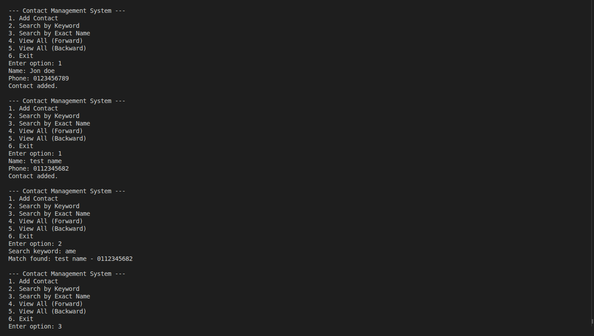
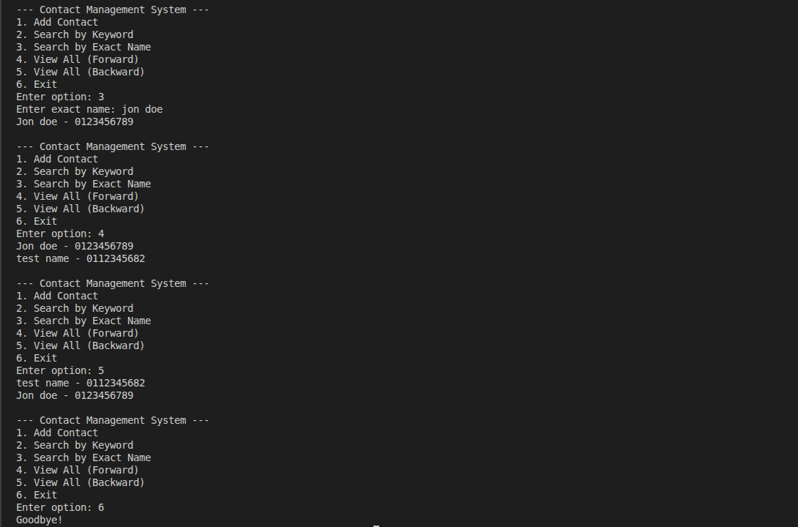

# Contact Management System

A simple command-line Contact Management System built with Python. It uses a **Doubly Linked List** to store and display contacts and a **Hash Table (Python dictionary)** to search for contacts by their exact names.

## Features

- **Add Contact:** Add a contact with a name and phone number.
- **Search by Keyword:** Find contacts whose names contain a specific keyword using a naive substring search algorithm.
- **Search by Exact Name:** Find a contact using their complete name and a hash table.
- **View All Contacts (Forward):** Display contacts from first to last.
- **View All Contacts (Backward):** Display contacts from last to first.
- **Case-Insensitive Search:** Search for names regardless of capitalization.
- **Duplicate Prevention:** Prevent adding contacts with the same name, regardless of capitalization.

## Data Structures and Algorithms

### 1. Doubly Linked List

The doubly linked list stores contacts in the order they are added.

Each node contains:

- The contact's information.
- A pointer to the previous node (`prev`).
- A pointer to the next node (`next`).

This structure allows contacts to be displayed in both forward and backward directions.

### 2. Hash Table

A Python dictionary is used as a hash table to store contacts, with lowercase names as keys.

This allows efficient average-case lookup by exact name, typically **O(1)**.

### 3. Naive Substring Search

The naive substring search algorithm checks whether a keyword appears within a contact's name.

It compares the keyword with successive portions of the name until a match is found or all possible positions have been checked.

Its worst-case time complexity is **O(n × m)**, where:

- `n` is the length of the contact's name.
- `m` is the length of the keyword.

## Technologies Used

- Python 3
- Object-Oriented Programming (OOP)
- Doubly Linked List
- Hash Table (Python dictionary)
- Naive Substring Search Algorithm

## Tests

The following screenshot shows the Contact Management System being tested in the terminal.

